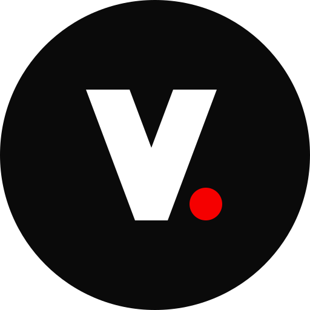
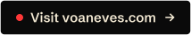
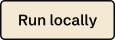

<a id="top"></a>

<div align="center">

<picture>
  <source media="(prefers-color-scheme: dark)" srcset="https://raw.githubusercontent.com/voaneves/site/main/assets/logo/logo-dark.svg" />
  <source media="(prefers-color-scheme: light)" srcset="https://raw.githubusercontent.com/voaneves/site/main/assets/logo/logo-light.svg" />
  
</picture>

<h1>voaneves.com</h1>

<p>
  <strong>Personal website and consulting portfolio of Victor Neves, built with Astro and Cloudflare Pages.</strong><br />
  <sub>
    Bilingual static site (PT-BR &amp; EN) — <kbd>Astro 7</kbd> · <kbd>TypeScript</kbd> · <kbd>Cloudflare Pages</kbd> · <kbd>Playwright</kbd>
  </sub>
</p>

<p>
  <a href="https://voaneves.com/en/"><picture><source media="(prefers-color-scheme: dark)" srcset="https://raw.githubusercontent.com/voaneves/site/main/assets/buttons/live-dark.svg" /></picture></a>
  <a href="#getting-started"><picture><source media="(prefers-color-scheme: dark)" srcset="https://raw.githubusercontent.com/voaneves/site/main/assets/buttons/run-dark.svg" /></picture></a>
</p>

<p><sub>Need a site like this? <a href="https://voaneves.com/en/#contact"><strong>Let's talk →</strong></a></sub></p>

<p>
  <a href="https://github.com/voaneves/site/actions/workflows/ci.yml"></a>
  
  <a href="./lighthouserc.cjs"></a>
  <a href="./LICENSES.md"></a>
</p>

</div>

<picture>
  <source media="(prefers-color-scheme: dark)" srcset="https://raw.githubusercontent.com/voaneves/site/main/assets/brand/rule-dark.svg" />
  <source media="(prefers-color-scheme: light)" srcset="https://raw.githubusercontent.com/voaneves/site/main/assets/brand/rule-light.svg" />
  
</picture>

<details>
  <summary><strong>Contents</strong> — jump to a section</summary>

- [Overview &amp; Stack](#overview)
- [Getting started](#getting-started)
- [Scripts](#scripts)
- [Project structure](#project-structure)
- [Quality](#quality)
- [Deployment](#deployment)
- [Contact](#contact)

</details>

<a id="overview"></a>
## Overview

Read the bilingual consulting portfolio, project case studies, and service overview of Victor Neves on a fast static Astro site deployed to Cloudflare Pages.

<a id="stack"></a>
### Stack

- [Astro](https://astro.build) 7 (static output, MDX, sitemap with localized alternates)
- TypeScript
- [`@voaneves/brand`](https://github.com/voaneves/brand): design tokens, CSS, JS, fonts, icons and logo (vendored as a tarball in `vendor/`)
- Cloudflare Pages, deployed with Wrangler
- Tests: Node test runner (`node --test`) and [Playwright](https://playwright.dev) with axe-core
- Lint: oxlint
- Quality gates: Lighthouse CI and a size budget

### Features

- Two locales: `pt-br` (default, no prefix) and `en` (`/en/`), with localized route pairs and `hreflang` alternates in the sitemap.
- Home page, project case studies (`/projetos/<slug>/`, `/en/projects/<slug>/`) and privacy pages.
- Strict Content Security Policy generated at build time (inline scripts are hashed).

<a id="getting-started"></a>
## Getting started

Requires Node.js 24 or newer (see `.nvmrc`).

```bash
npm install
npm run dev      # Astro dev server
npm run build    # static build into dist/
npm run preview  # serve dist/ with Wrangler Pages on port 8788
```

## Scripts

| Command | What it does |
| :--- | :--- |
| `npm run dev` | Starts the Astro dev server |
| `npm run build` | Builds the static site into `dist/` |
| `npm run preview` | Serves `dist/` locally with `wrangler pages dev` |
| `npm run lint` | Runs oxlint on `src`, `scripts` and `tests` (warnings fail) |
| `npm test` | Runs the unit and build-output tests in `tests/` |
| `npm run check:budget` | Checks HTML, inline CSS and JS sizes against `budget.json` |
| `npm run check:html` | Validates the generated HTML in `dist/` |
| `npm run e2e` | Runs the Playwright end-to-end and accessibility suite |

## Project structure

```
src/
  pages/        routes (pt-br at the root, English under en/)
  components/   page and UI components
  layouts/      base layout (head, theme, CSP hash source)
  i18n/         route pairs, SEO helpers, UI strings
  data/         portfolio, contact and project data
  styles/       styles
public/         static assets
tests/          Node tests (SEO, links, security headers, budget, i18n, routes)
e2e/            Playwright specs (accessibility, interactions, themes, SEO)
scripts/        budget and HTML checks, e2e sharding
ops/            expected Cloudflare configuration
docs/           GitOps runbook and project plans
vendor/         vendored @voaneves/brand package
```

<a id="quality"></a>
## Quality

- **Lighthouse CI** (`lighthouserc.cjs`) asserts a score of 1 (100) for performance, accessibility, best practices and SEO on mobile and desktop, with limits for LCP, CLS and total blocking time.
- **Accessibility:** Playwright specs use `@axe-core/playwright`.
- **Performance budget** (`budget.json`): caps on gzipped HTML, inline CSS, first-load JS and lazy chunks, enforced by `npm run check:budget`.
- **CI:** lint, tests, build, budget, HTML check, Playwright and Lighthouse on every pull request; CodeQL, uptime monitoring and a weekly audit run on schedule.

<a id="deployment"></a>
## Deployment

Pushes to `main` run CI, publish a candidate to Cloudflare Pages, smoke test it, promote it to production and roll back automatically on failure. Pull requests get an isolated preview. See [docs/GITOPS_RUNBOOK.md](docs/GITOPS_RUNBOOK.md) (in Portuguese).

## Related

- Brand and design system: [voaneves/brand](https://github.com/voaneves/brand)
- Author profile: [github.com/voaneves](https://github.com/voaneves)

## License

Code is MIT, see [LICENSE](LICENSE). Fonts are SIL OFL 1.1; logo, wordmark, photos, CV and written content are all rights reserved. Details in [LICENSES.md](LICENSES.md).

<a id="contact"></a>
## Contact

<p>
  <a href="https://voaneves.com/en/#contact"><picture><source media="(prefers-color-scheme: dark)" srcset="https://raw.githubusercontent.com/voaneves/site/main/assets/buttons/hire-dark.svg" /></picture></a>
  <a href="https://voaneves.com/en/"><picture><source media="(prefers-color-scheme: dark)" srcset="https://raw.githubusercontent.com/voaneves/site/main/assets/buttons/site-dark.svg" /></picture></a>
</p>

<a href="https://www.linkedin.com/in/voaneves/">LinkedIn</a> · <a href="mailto:victorneves478@gmail.com">E-mail</a>

<div align="center">
  
</div>

<p align="center"><sub>Code under <a href="./LICENSE">MIT License</a> · See <a href="./LICENSES.md">LICENSES.md</a> for brand asset rights © 2026 <a href="https://github.com/voaneves">Victor Neves</a> · <strong>VOANEVES.</strong></sub></p>

<p align="center"><sub><a href="#top">↑ Back to top</a></sub></p>
